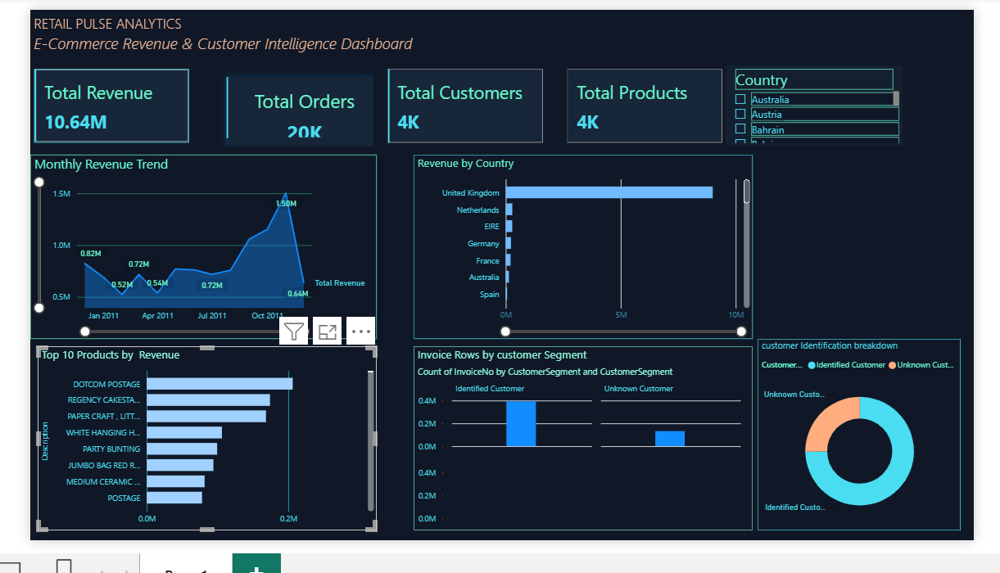

# Retail Pulse Analytics
### E-Commerce Revenue & Customer Intelligence Analytics

## Project Overview
Retail Pulse Analytics is an end-to-end e-commerce analytics project using Python, SQL, Excel, and Power BI to explore retail transactions, prepare sales data, analyze business metrics, and visualize revenue and product performance.

## Dashboard Preview

## Project Objectives
- Analyze e-commerce revenue and order activity.
- Explore monthly revenue trends.
- Identify top-performing products and countries.
- Investigate missing values, duplicate records, and unusual transactions.
- Build an interactive business intelligence dashboard.

## Dataset
- **Dataset:** UCI Online Retail
- **Period:** December 2010 – December 2011
- **Original data:** 541,909 rows and 8 columns.
- **After duplicate removal:** 536,641 rows.
- **Filtered sales dataset:** 524,878 rows and 9 columns.

## Tools and Technologies
- Python — Pandas, Matplotlib
- SQL — MySQL
- Microsoft Excel — formulas and PivotTables
- Power BI — interactive dashboards and visualization
- DAX — business metrics

## Project Workflow

### 1. Python EDA
- Inspected dataset structure and descriptive statistics.
- Identified missing values and duplicate records.
- Examined negative quantities, non-positive prices, and cancellation invoices.
- Created monthly revenue, top 10 products, and top 10 countries visualizations.

### 2. SQL Analysis
- Calculated total revenue, orders, customers, and products.
- Analyzed monthly and country-wise revenue.
- Identified top 10 products by revenue.
- Calculated average order value.

### 3. Excel Analysis
- Created a Revenue column using Quantity × UnitPrice.
- Calculated summary metrics, including total revenue, orders, customers, products, and average order value.
- Started a PivotChart for revenue analysis.

### 4. Power BI Dashboard
- Created KPI cards for Total Revenue, Total Orders, Total Customers, and Total Products.
- Built monthly revenue, country revenue, top product, and customer identification visuals.
- Added an interactive country slicer.

## Data Preparation
- Removed duplicate records.
- Excluded invoice numbers beginning with `C` from the filtered sales analysis.
- Retained records with positive quantities and positive unit prices.
- Calculated revenue as Quantity × UnitPrice.

## Key EDA Findings
- Description had 1,454 missing values (0.27%).
- CustomerID had 135,037 missing values (25.16%).
- The cleaned dataset contained 10,587 negative-quantity rows, 2,512 non-positive-price rows, and 9,251 rows with invoice numbers beginning with `C`; these categories may overlap.

## Project Files
- `Retail Pulse Analytics.pbix` — Power BI report
- `retail-pulse-dashboard.png` — dashboard screenshot
- `retail_pulse_eda.ipynb` — Python EDA notebook
- `retail_pulse_analysis.sql` — SQL analysis queries

## Skills Demonstrated
Data cleaning, exploratory data analysis, SQL querying, Excel analysis, DAX measures, KPI analysis, data visualization, and business intelligence.

## Project Status
Power BI dashboard completed; supporting EDA, SQL, and Excel analysis documented as part of the project workflow.
